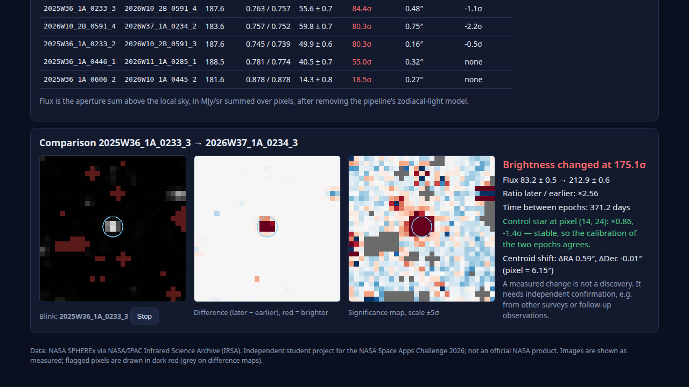
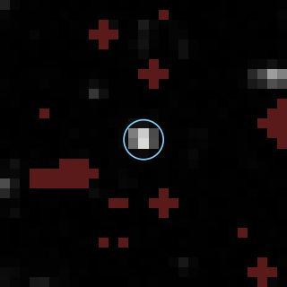
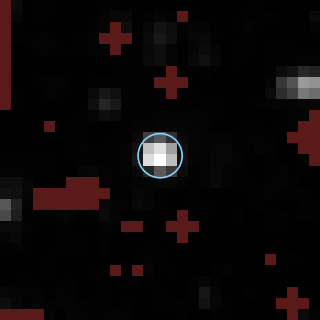
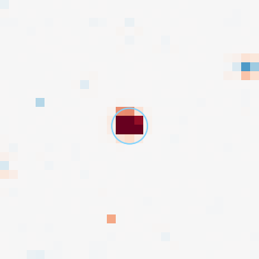
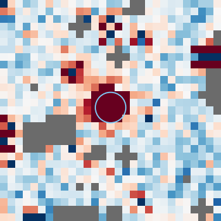

# HIPPARCHUS

**Has this star really changed?** HIPPARCHUS compares real NASA SPHEREx infrared images of the same star taken at
different times, and tells you whether the change is real, or why the comparison can't be trusted.

Team **AETHENOVA** · NASA Space Apps Challenge 2026, *Planet X and SPHEREx* (Athens) · *Ancient curiosity. Infinite discovery.*

[**Live demo (Judge Mode)**](https://evantampa129.github.io/HIPPARCHUS-SpaceApps2026/) ·
[29 s film](video/hipparchus_aethenova_29s.mp4) ·
[6-slide presentation](presentation/HIPPARCHUS_AETHENOVA_FINAL.pdf) ·
[Research report](report/HIPPARCHUS_AETHENOVA_FINAL.pdf) ·
[Reproduce](#reproduce-the-results) ·
[Sources & licences](docs/RESOURCES_AND_CREDITS.md)



## Why we built it

SPHEREx maps the whole sky every six months in 102 infrared colours. That makes it a natural place to look for things
that change or move, all the way out to a distant planet. But two SPHEREx images of the same star are rarely directly
comparable:

- the linear variable filters put the star at a different wavelength in each visit,
- bright stars saturate (Barnard's Star is flagged in all 58 of its epochs),
- zodiacal light changes with the season.

Subtract two images naively and you get "variability" that is only the instrument. We wanted a tool that checks first,
measures second, and then tries to break its own result.

## What it does

**Observe → Verify → Challenge → Explain.**

1. **Observe.** We search IRSA live for SPHEREx DR1 and QR3 images of a position and download small cutouts. Every
   archive answer and every cutout gets a SHA-256 checksum.
2. **Verify.** For each epoch we remove the zodiacal model, read the wavelength at the star, check 18 flag planes and
   the variance. Two epochs are paired only if they come from the same detector and differ by at most half a channel in
   wavelength. Otherwise we refuse the pair and say why.
3. **Challenge.** We repeat the measurement with other apertures, sky annuli, masks, calibrations and wavelength rules,
   and with each pair left out. A second, independent measurement fits the SPHEREx PSF to the raw pixels.
4. **Explain.** Each result comes with formal and systematic errors, the reasons for any refusal, and an evidence file
   that rebuilds it.

## What we found (three real stars)

| Target | Answer | Key numbers |
|---|---|---|
| RW Aur | **Measured change** | ×2.56 brighter in a year at 0.76 µm. 175σ formal, ≈12σ with a 12.5% calibration floor. 8 of 1540 pairs pass. |
| Barnard's Star | **Comparison refused** | 0 of 58 epochs usable: saturation flags on the star in every one. |
| WISE 0855 | **No significant change** | 27 valid pairs, largest change 1.9σ. Too faint to prove it is constant. |

RW Aur is a known variable young binary. At 6.15″ pixels both stars (1.6″ apart) fall in our aperture, so this is a
measurement of the pair, not a discovery. **HIPPARCHUS has not found Planet X**, and we don't claim it has.

<p>




</p>

*RW Aur in SPHEREx: two epochs a year apart, their difference and the per-pixel significance. SPHEREx data from
NASA/IPAC IRSA, processed by HIPPARCHUS.*

## How we know it works

- **Null test.** We run the same photometry at blank positions in every valid pair. The significances spread 0.91
  (n = 93; 1 is ideal) and none goes past 3σ.
- **Injection-recovery (SIMULATED).** We add fake stars of known brightness to real images. 44% are recovered at S/N 5,
  99% at S/N 7, as a 5σ threshold should give. Fake stars are labelled SIMULATED everywhere and never enter a result.
- **Stability fingerprint.** "RW Aur brightened ×1.5 or more at ≥5σ" holds in 24/24 settings (robust). "Brighter in
  every pair" holds in 18/24 (sensitive: it fails with a 1.5 px aperture). "WISE 0855 has no ≥5σ change" holds in
  34/34. These labels follow a fixed rule; they are not probabilities.
- **Second measurement (experimental).** Fitting the SPHEREx ePSF to the native pixels reproduces all 8 RW Aur ratios
  within 2%. We don't use it for any published number yet.
- **Control stars** in the same images stay within ×0.86–1.07 while RW Aur changes by ×2.5.
- **Catalogue match.** SIMBAD and Gaia DR3 put all three target positions on the right star.
- **Evidence graph.** Every number links back to its cutout checksum, the archive answer and the dataset DOI. A test
  fails if any link breaks.

What we did not do: no machine-learning ranking. With three targets and no labelled examples there is nothing to train
or test one on fairly.

## Run it

```bash
cd backend && python3 -m venv .venv && . .venv/bin/activate && pip install -e ".[dev]"
pytest                                                   # automated tests, on real SPHEREx cutouts
cd ../frontend && npm install && npm run build           # builds frontend/dist
cd ../backend && uvicorn hipparchus.serve:app --port 8080  # app + API on http://localhost:8080
```

The first analysis of a target downloads its cutouts (1–4 minutes); after that it reads from the cache.

## Reproduce the results

```bash
cd backend
python scripts/reproduce_evidence.py     # submission/evidence/*.json
python scripts/reproduce_validation.py   # null test, SIMULATED injection-recovery, evidence graphs
python scripts/reproduce_catalogs.py     # SIMBAD + Gaia DR3 match (needs network)
python scripts/reproduce_robustness.py   # stability fingerprint (~30 s)
python scripts/reproduce_epsf.py         # experimental ePSF check (~12 s)
python scripts/make_judge_site.py        # docs/index.html (Judge Mode)
cd ../report && ./reproduce_report.sh    # report PDF
cd .. && backend/.venv/bin/python presentation/build_deck.py   # six-slide deck
```

## Repository layout

```
backend/       Python: archive search, cutouts, quality checks, comparison, ePSF photometry, tests, scripts
frontend/      React/TypeScript app: timeline, playback, blink, difference and significance maps
docs/          Judge Mode page (GitHub Pages), its images, provenance, references, AI use, credits
submission/    evidence files with checksums
report/        research report (LaTeX + PDF), figures, bibliography
presentation/  six-slide deck (PPTX + PDF) and the script that builds it, screenshots, logos
video/         29 s film (MP4 + captions), its editable Remotion source, credits and QC frames
```

## Data, credits and AI use

- Images: SPHEREx DR1 (doi:10.26131/IRSA678) and QR3 (doi:10.26131/IRSA662) from the NASA/IPAC Infrared Science
  Archive. How we fetch and record them: [docs/DATA_PROVENANCE.md](docs/DATA_PROVENANCE.md).
- References: [docs/SCIENTIFIC_REFERENCES.md](docs/SCIENTIFIC_REFERENCES.md). Software and assets:
  [docs/RESOURCES_AND_CREDITS.md](docs/RESOURCES_AND_CREDITS.md).
- AI tools helped with the logos (marked "AI-generated"), the video edit, code, method review and writing. They did not
  produce any measurement or validate the science. Details: [docs/AI_USAGE_DISCLOSURE.md](docs/AI_USAGE_DISCLOSURE.md).
- What is finished and what is experimental: [FINAL_IMPLEMENTATION_CHECKLIST.md](FINAL_IMPLEMENTATION_CHECKLIST.md).
- Independent work by team AETHENOVA. NASA has not endorsed it, and it uses no NASA logos or insignia.

MIT licence (see `LICENSE`).
